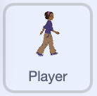
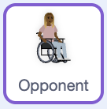
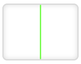

## Tagging and being caught

Make the tagging and scoring work.

### Tagging opponents

--- task ---

Create a new `broadcast`{:class='block3events'} with the message `tag opponent`. This will be used to keep track of how many opponents the player tags.

--- /task ---

--- task ---

Add this code to the **Player** sprite, so that it identifies when the player tags an opponent:



```blocks3
when I receive [start v]
set size to (25)%
go to x:(-160) y:(0)
wait (1) seconds
repeat until <(lives) = (0)>
    if <key (up arrow v) pressed?> then 
        change y by (10)
    end
    if <key (down arrow v) pressed?> then 
        change y by (-10)
    end
    if <key (right arrow v) pressed?> then 
        change x by (10)
    end
    if <key (left arrow v) pressed?> then 
        change x by (-10)
    end
+    if <touching (Opponent v)?> then
        broadcast (tag opponent v)
+    end
end
```

--- /task ---

--- task ---

On the **Opponent** sprite, add this new code to remove opponents who are tagged:



```blocks3
when I receive (tag opponent v)
if <touching (Player v)> then
    delete this clone
end
```

--- /task ---

--- task ---

The Stage will handle the scoring in the game. Add these blocks to the **Stage**:



```blocks3
when I receive (tag opponent v)
change [opponent tagged v] by (1)
```

--- /task ---

--- task ---

**Test your code.** Click on the green flag and make sure the opponent tagging works: the score should change and each clone should disappear when touched by the player.

--- /task ---

### Being caught

In kabaddi, the player must tag opponents, but not get caught themselves. In this game, if more than one opponent is touching the player, the player has been caught. You need to make a way to identify if more than one opponent is touching the player.

--- task ---

On the **Stage**, make a new `variable`{:class='block3variables'} called `touching`.

--- /task ---

--- task ---

On the **Opponent** sprite, make a variable called `touching player`{:class='block3variables'} and choose **For this sprite only**. Untick its checkbox. Each clone needs its own copy so it can remember whether it was touching the player when counted.

Create a new `broadcast`{:class='block3events'} message called `count opponents`. Add a receiver that resets the clone's `touching player`{:class='block3variables'} flag to `0`. If the clone is touching the player, set its flag to `1` and add `1` to the shared `touching`{:class='block3variables'} count.


```blocks3
when I receive (count opponents v)
set [touching player v] to (0)
if <touching (Player v)?> then
    set [touching player v] to (1)
    change [touching v] by (1)
end
```

--- /task ---

--- task ---

Update the **Opponent** sprite's earlier `tag opponent`{:class='block3events'} receiver to check its saved flag instead of checking contact again. This makes it delete the same clone that was counted, even if an opponent moves before the message arrives.

```blocks3
when I receive (tag opponent v)
if <(touching player) = (1)> then
    delete this clone
end
```

--- /task ---

--- task ---

Create a new `broadcast`{:class='block3events'} with the message `tag player`.

--- /task ---

--- task ---

On the **Stage**, set `touching`{:class='block3variables'} to `0` before broadcasting `start`{:class='block3events'}:


```blocks3
when green flag clicked
set [lives v] to (5)
set [opponent tagged v] to (0)
+set [touching v] to (0)
broadcast (start v)
forever
    if <(opponent tagged) = (7)> then
        broadcast (win v)
        wait (3) seconds
    end
    if <(lives) = (0)> then
        broadcast (lose v)
        wait (3) seconds
    end
end
```

--- /task ---

Count the opponents before deciding who has been tagged. Each count starts at zero, so deleting a tagged clone cannot leave an old contact in the total.

--- task ---

On the **Player** sprite, replace the `if touching Opponent`{:class='block3control'} section inside the movement loop with these blocks. Leave the arrow-key checks above them.

Use `broadcast and wait`{:class='block3events'} so every opponent finishes counting before the player checks the total. If more than one opponent touches the player, the player is caught. If exactly one touches, that opponent is tagged.

```blocks3
set [touching v] to (0)
broadcast (count opponents v) and wait
if <(touching) > (1)> then
    broadcast (tag player v) and wait
else
    if <(touching) = (1)> then
        broadcast (tag opponent v) and wait
    end
end
```

--- /task ---

If more than one opponent touches the player, the player has been 'tagged' and needs to lose a life and go back across the green line.

--- task ---

Add this code to the **Player** sprite, so that the player moves back to the starting position and loses a life if they are tagged:


```blocks3
when I receive (tag player v)
go to x:(-160) y:(0)
change [lives v] by (-1)
```

--- /task ---

--- task ---

**Test your code.** Click on the green flag and tag one opponent, then approach two opponents together. One opponent should disappear and add one point; two opponents should cost one life and send the player back across the green line. Repeat this after several successful tags to check that old contacts are not counted.

--- /task ---

In the next step, you will make the player 'say kabaddi' using a key press.

--- save ---

